# Front matter

| | |
|---|---|
| **Name** | ⏳ *your full name* |
| **Roll number** | L230518 |
| **Project name** | L230518_A2_Ops (GitHub, DagsHub, registry, GCP project and Cloud Run service) |
| **GitHub** | https://github.com/Rebelhere/L230518_A2_Ops |
| **DagsHub** | https://dagshub.com/Rebelhere/L230518_A2_Ops (data, experiments, model registry) |
| **MLflow tracking** | https://dagshub.com/Rebelhere/L230518_A2_Ops.mlflow |
| **Model API (Cloud Run)** | ⏳ `https://l230518-a2-ops-api-….run.app` |
| **Web app** | Runs on localhost (`docker compose up`) and calls the cloud API, as Task 7 requires |
| **Graded commit** | ⏳ `git rev-parse HEAD` at submission |

**Disclosure of AI assistance.**
- **Claude Code (Anthropic), used as a coding assistant in VS Code.** It helped me:
  - write and debug the Flask app, model API, Dockerfiles, Compose file, CI workflow, tests and Grad-CAM script;
  - plan the cloud deployment;
  - draft and structure this report from my terminal output and screenshots.
- **My own work:** I ran every command, training run, experiment and deployment myself. I took the screenshots and checked every number in the report against my own outputs.
- **Other sources:**
  - the official TensorFlow/Keras, MLflow, DagsHub, DVC, Docker and Google Cloud Run documentation;
  - the Kaggle dataset page.

---

# Chapter 1: Data understanding and versioning

## 1.1 Environment

**What I did.**
- I created an isolated virtual environment (`python -m venv venv`) with Python 3.12.10 and installed TensorFlow 2.21.0, Keras 3.15.1, MLflow 3.17.2, DVC 3.67.1, DagsHub, Keras Tuner 1.4.8, pandas, scikit-learn, Pillow and Flask.
- I froze the exact versions into `requirements.txt` (`pip freeze`).

**Why.** A venv keeps the project's dependency versions separate from other projects. Freezing the list makes the training environment reproducible.

**Result.** `tf.config.list_physical_devices('GPU')` returns `[]`. TensorFlow ≥ 2.11 has no GPU support on native Windows (it needs WSL2), so all training ran on the CPU (Figure 1.1).

**What went wrong.** `pip freeze > requirements.txt` in PowerShell 5.1 writes UTF-16. Linux `pip` inside Docker can't read that, so I later re-saved the file as UTF-8.

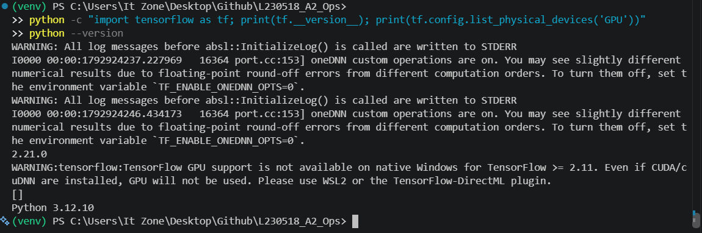

## 1.2 Dataset audit

**What I did.** `scripts/audit.py` walks `data/`. For every file it records:
- class (taken from the folder name);
- file size, width, height, colour mode and format (read with Pillow);
- SHA-256 of the file's bytes.

The full table is `reports/audit.csv`. A file that fails `Image.open().verify()` counts as corrupt. Rows that share a hash are exact duplicates.

**Results** (Figures 1.2a–b):

| | AI | Real |
|---|---|---|
| Images | **539** | **435** |
| Width min / median / max (px) | 225 / 1024 / 6000 | 183 / 940 / 8495 |
| Height min / median / max (px) | 135 / 800 / 4001 | 158 / 720 / 7091 |
| File size min / median / max | 11.7 KB / 199.8 KB / 5.6 MB | 11.3 KB / 145.0 KB / 10.2 MB |

- **Corrupt files:** 0.
- **Exact duplicates:** 1. I kept one copy, so the same image can't land in both train and test.
- **Colour modes:** RGB 895, RGBA 49, P (palette) 23, L (greyscale) 7.
- **Formats:** JPEG 831, PNG 143.
- **Split:** stratified 70/15/15 with seed 42:

| Split | Images | AI | Real |
|---|---|---|---|
| Train | 681 | 377 | 304 |
| Validation | 146 | 81 | 65 |
| Test | 146 | 80 | 66 |

The split lists are in `splits/*.csv`, with path, label and hash.

**Interpretation.**
- The classes are mildly imbalanced (55% AI), so accuracy alone is misleading. I also report precision, recall, F1 and ROC-AUC.
- The colour modes are mixed. The input pipeline therefore forces 3 channels, which drops alpha and expands greyscale.

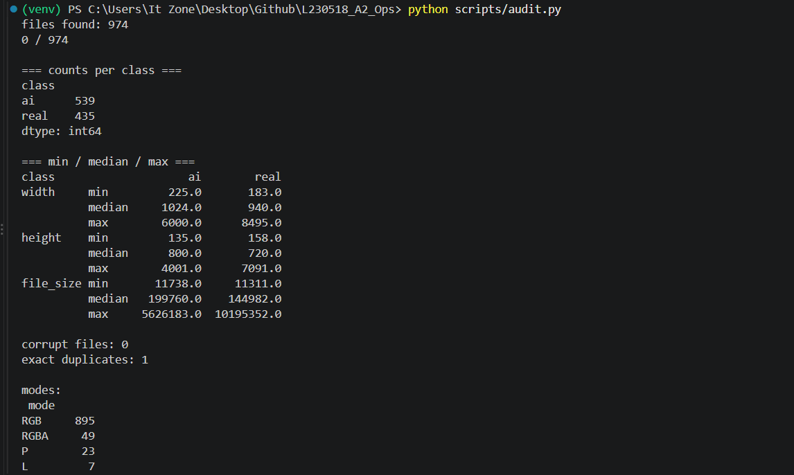
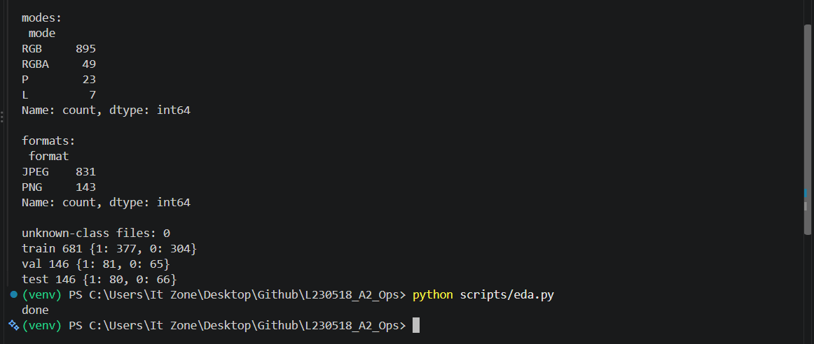

## 1.3 Visual EDA

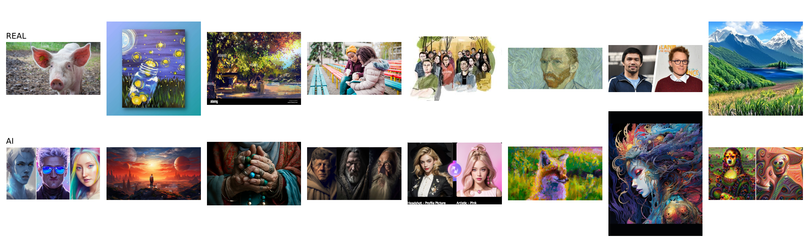

**Figure 1.3a** shows random samples from each class.
- The "real" class is not only photographs. It also contains paintings, drawings, collages and stock-photo grids.
- The AI class leans toward saturated, smooth, "digital-art" portraits and fantasy scenes.

So the model can partly learn *style* instead of *generation artefacts*, and real paintings are likely to be confused with AI art.

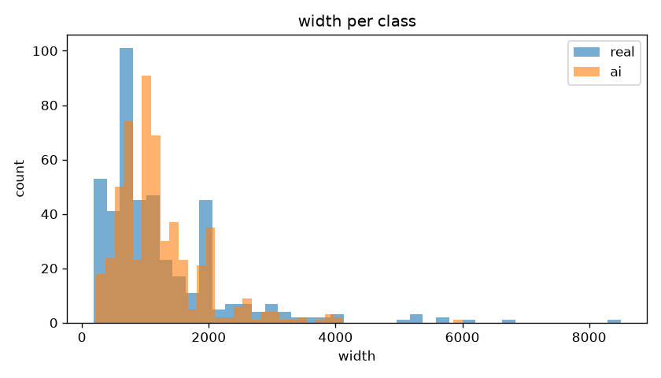
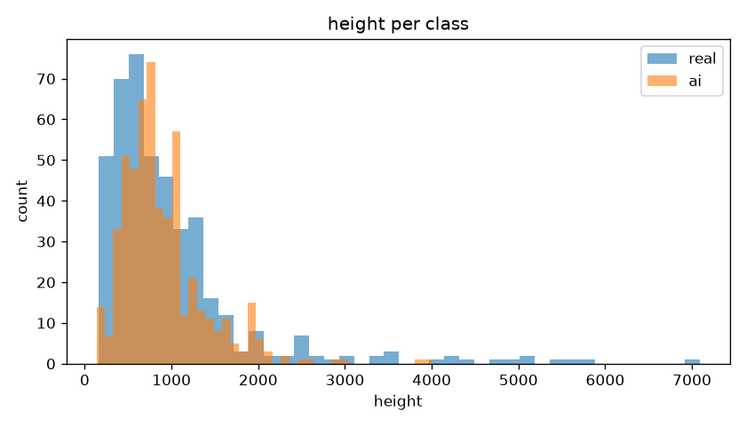
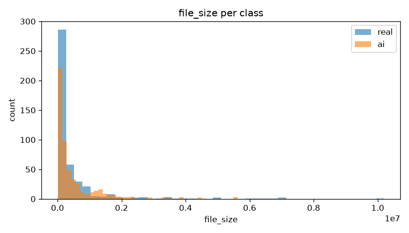

**Figures 1.3b–c (width and height).**
- Both classes peak below 2000 px.
- AI images cluster at generator-native sizes around 1024 px (and 512/2048).
- Real images spread wider, with a long tail up to 8495 px.

Size alone carries a weak class signal. Resizing everything to 224×224 removes it, which is good, because a classifier should not depend on resolution.

**Figure 1.3d (file size).** Real files have the heavier tail (camera JPEGs up to 10 MB), while AI files are more uniform. This decided the upload limit for the web app: 5 MB, which covers about 99% of the data.

## 1.4 DVC (data version control)

**Toy part** (folder `dvc_toy`, Figures 1.4a–h). These are the steps, in order:
1. `git init` and `dvc init`.
2. Create a 3-row `data.csv`, then `dvc add data.csv`. This creates the pointer `data.csv.dvc` and adds `data.csv` to `.gitignore`. Then commit (v1).
3. Append a row, run `dvc add` again and commit (v2).
4. `git checkout HEAD~1 -- data.csv.dvc` followed by `dvc checkout` brought back the **3-row** version. `git checkout HEAD -- data.csv.dvc` and `dvc checkout` returned the 4-row version.
5. Add a local folder remote (`dvc remote add -d localremote …`) and `dvc push`.
6. Delete `data.csv` **and** `.dvc/cache`, then `dvc pull`. The pull printed "1 file fetched and 1 file added", so the file was restored from the remote.
7. Push the Git history to DagsHub (`Rebelhere/L230518_A2_Ops_toy`). DagsHub shows `data.csv` as a DVC-tracked file next to its pointer.

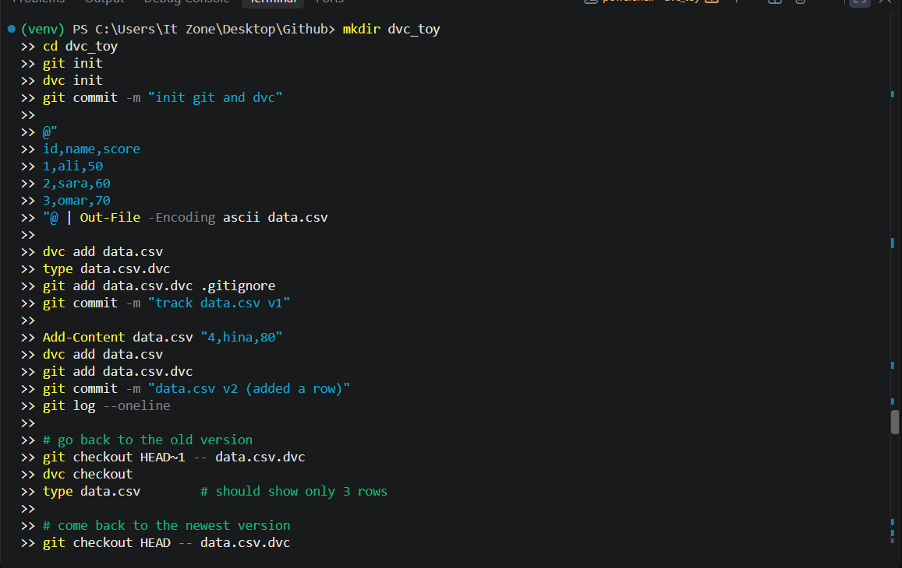
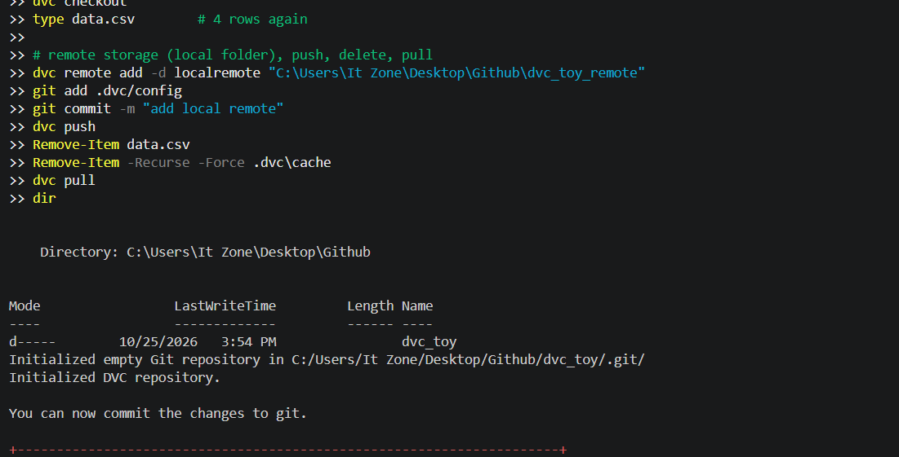
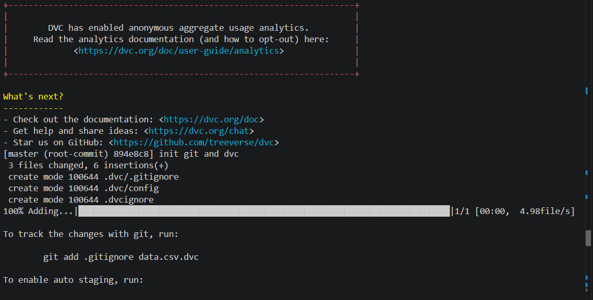
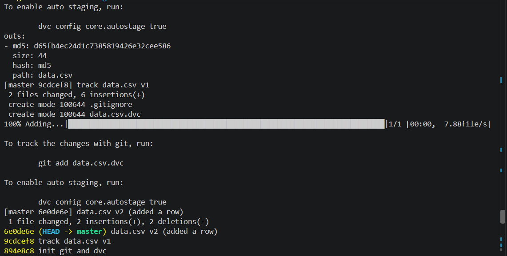
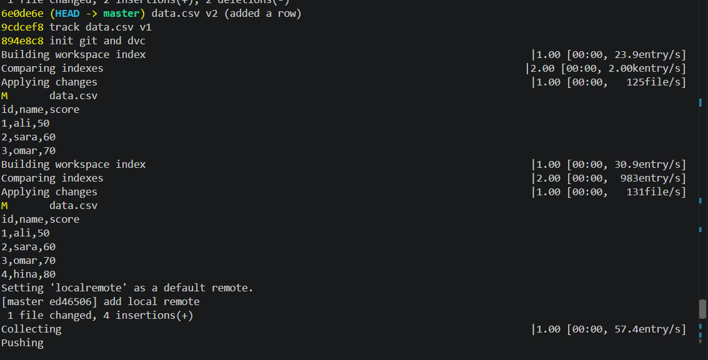
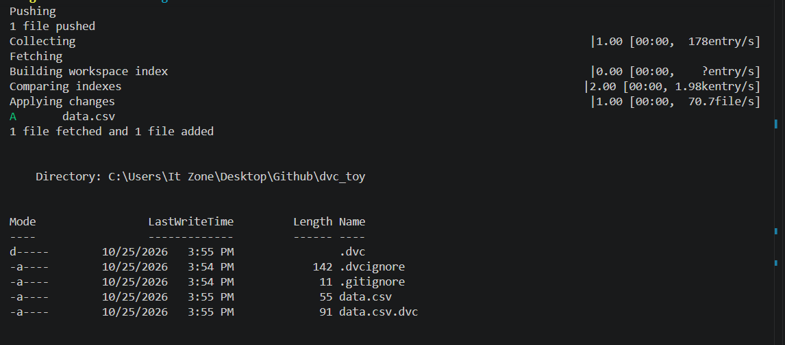
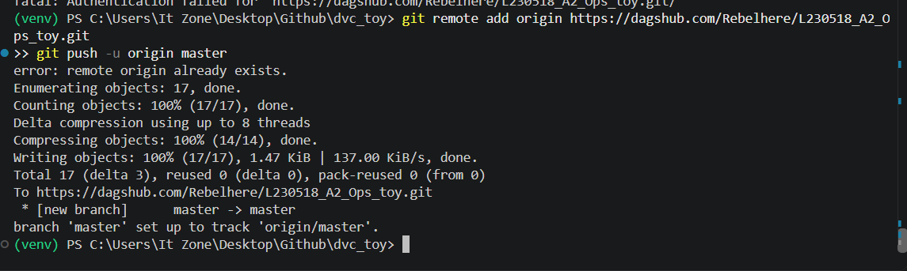
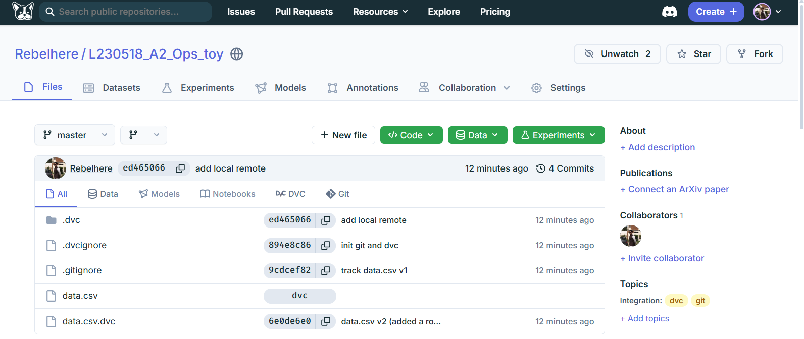

**Apply.**
- I tracked the whole `data/` folder with `dvc add data`, using DagsHub storage as the `origin` remote.
- `data.dvc` (Figure 1.4i) holds the directory hash `b2cec678…​.dir`, the size (503,783,378 bytes) and the file count (975).
- `dvc status -c` reports "Cache and remote 'origin' are in sync" (Figure 1.4j).
- DagsHub and GitHub both show `data` as DVC-managed. Only the pointer is in Git (Figures 1.4k–l).

**What the pointer file holds and why large data stays out of Git.**
- The `.dvc` file is a few lines of YAML: a content hash (md5), a size, a file count and a path. The hash is the address of the real content in the DVC cache and remote, so the Git commit pins *exactly* which data version the code used.
- Git stores every version of every file forever and diffs them as text. A 500 MB image folder would bloat every clone, slow every operation, and exceed GitHub's size limits.
- DVC stores the data once per content hash in cheap object storage and keeps Git small.
- Every MLflow run is tagged with this hash (`dvc_data_md5`; see Chapter 3).

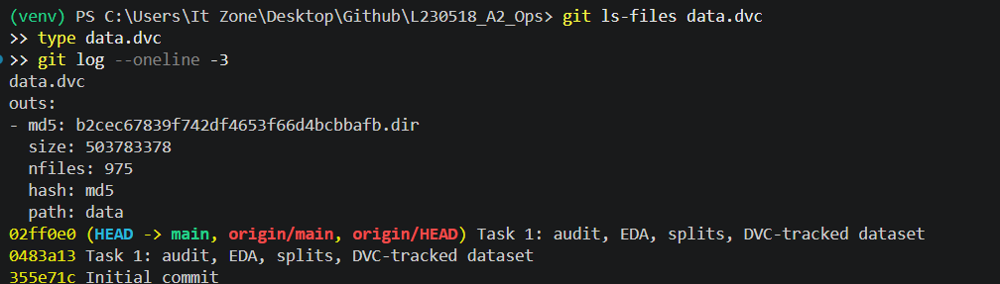
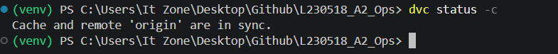
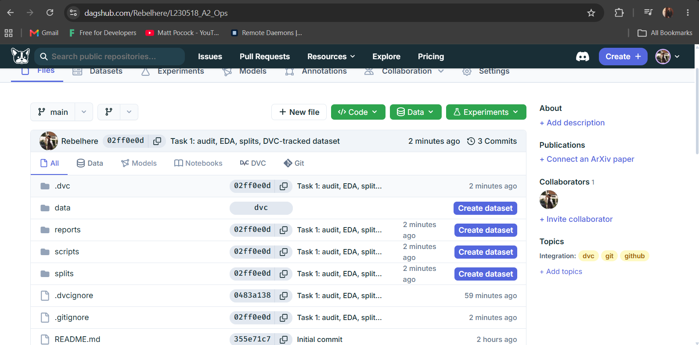
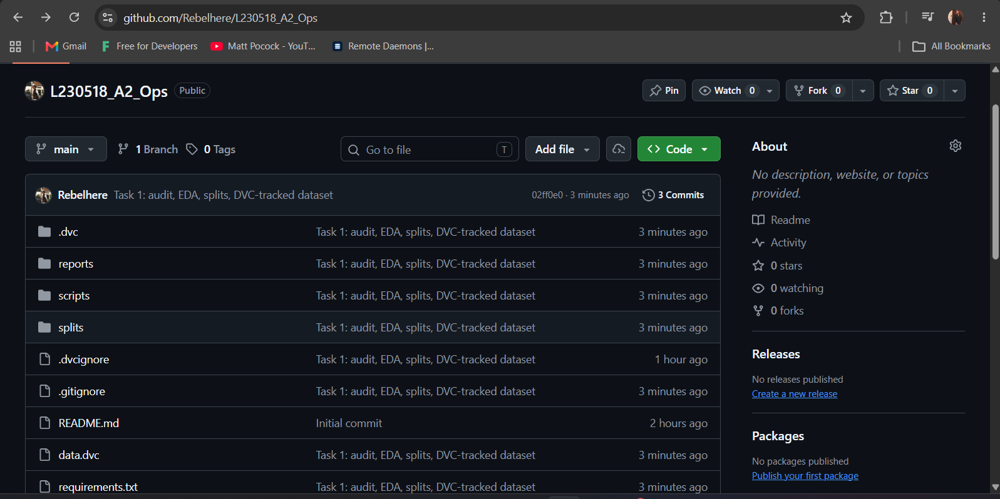

---

# Chapter 2: Model development with TensorFlow/Keras

## 2.1 Input pipeline

`src/data.py::make_ds` builds a `tf.data` pipeline. The stages, in order:
1. **Read split list.** `from_tensor_slices((paths, labels))` reads the paths and labels from `splits/<split>.csv`. Only these three lists are used, so no image can leak between splits.
2. **Decode and resize.** `map(_load, AUTOTUNE)` calls `src/preprocess.py::decode_resize`:
   - `tf.io.decode_image(channels=3, expand_animations=False)` handles both JPEG and PNG, forces 3 channels (drops alpha, expands greyscale and palette), and takes the first frame of a GIF-like file.
   - `tf.image.resize` makes the image 224×224 with bilinear interpolation, as float32 values in [0, 255].
3. **Cache.** `cache()` keeps the decoded images in memory after the first epoch. Decoding 5–10 MB JPEGs is the most expensive step.
4. **Shuffle.** `shuffle(len, seed=42, reshuffle_each_iteration=True)` runs on training data only.
5. **Augment** (training data only): `RandomFlip("horizontal")`, `RandomRotation(0.08)`, `RandomZoom(0.15)` and `RandomContrast(0.15)`. These perturbations are mild, so they don't destroy the high-frequency artefacts that separate AI images from real ones.
6. **Batch and prefetch.** `batch(32)` then `prefetch(AUTOTUNE)` lets the CPU prepare the next batch while the model trains on the current one.

**Image size.**
- **224×224** is the native ImageNet input of MobileNetV2, so the pretrained filters see objects at the scale they were trained on.
- It is also small enough for CPU training.

**Aspect ratio.**
- `tf.image.resize` **stretches** the image; it does not keep the aspect ratio. A 1024×576 image is squeezed horizontally.
- I chose stretching over crop or pad because cropping can cut off the part of the image that shows the artefact, and padding adds black borders the model could learn to use.
- The same stretch is applied in serving (Chapter 4), so training and serving still agree.

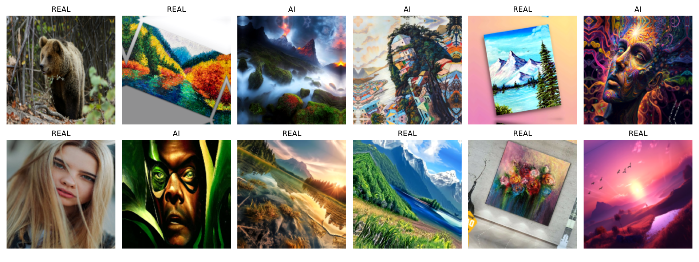

## 2.2 Baseline CNN

`src/models.py::build_cnn` (Figures 2.2a–c, table in `reports/cnn_layers.csv`):

| Layer | Output shape | Params | Why it is there |
|---|---|---|---|
| Input | (224, 224, 3) | 0 | raw RGB in [0, 255] |
| Rescaling(1/255) | (224, 224, 3) | 0 | puts inputs in [0, 1] so gradients are well-scaled |
| Conv2D 32, 3×3 (no bias) | (224, 224, 32) | 864 | learns local edges and texture; no bias because BN follows |
| BatchNormalization | (224, 224, 32) | 128 | stabilises and speeds up training |
| ReLU | (224, 224, 32) | 0 | non-linearity |
| MaxPooling2D | (112, 112, 32) | 0 | halves resolution, grows the receptive field |
| Conv 64 + BN + ReLU + Pool | (56, 56, 64) | 18,432 + 256 | mid-level patterns |
| Conv 128 + BN + ReLU + Pool | (28, 28, 128) | 73,728 + 512 | higher-level patterns |
| Conv 128 + BN + ReLU + Pool | (14, 14, 128) | 147,456 + 512 | |
| GlobalAveragePooling2D | (128) | 0 | one value per channel; far fewer weights than Flatten, so less overfitting |
| Dropout(0.4) | (128) | 0 | regularisation for a small dataset (681 training images) |
| Dense(1, sigmoid) | (1) | 129 | outputs p(AI) |
| **Total** | | **242,017** (241,313 trainable) | |

**Loss.** Binary cross-entropy is the correct likelihood for a single sigmoid output with 0/1 labels.

**Optimizer.** Adam at lr = 1e-3 gives robust default step sizes, so it needs no hand-tuned schedule (ReduceLROnPlateau handles the rest).

**Metrics.** Accuracy, precision, recall and AUC. Because the classes are imbalanced and the two errors cost differently (see 2.5), accuracy alone isn't enough. AUC measures ranking quality independently of the threshold.

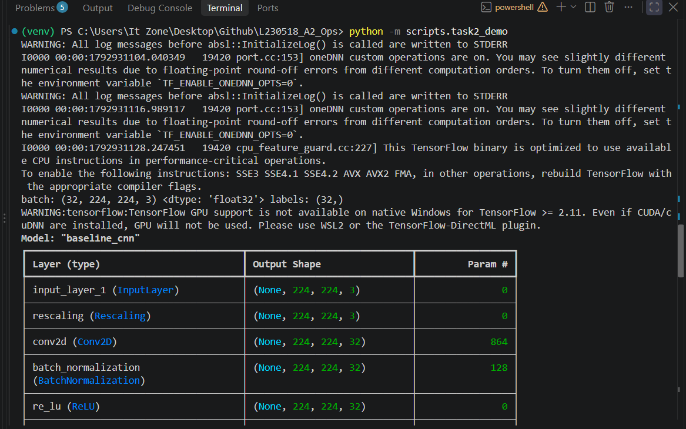
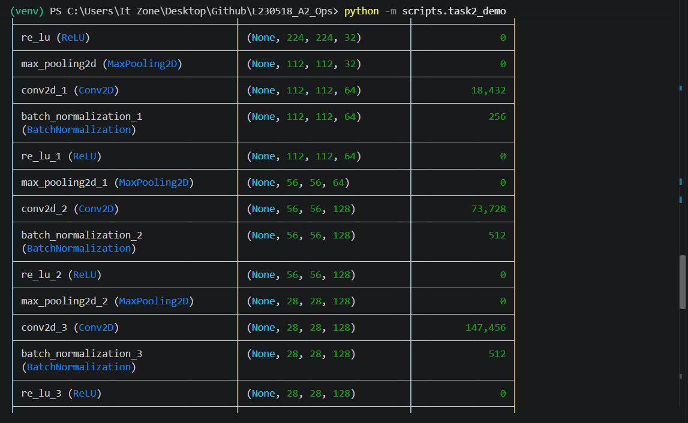
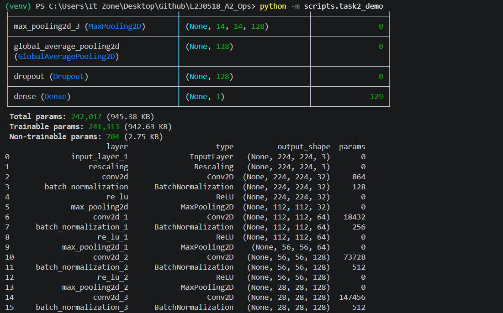

## 2.3 Transfer learning (MobileNetV2)

`src/models.py::build_mobilenet` loads `keras.applications.MobileNetV2(include_top=False, weights="imagenet")`, which leaves out the 1000-class classifier.

**Head.** GAP, then Dropout(0.3), then Dense(1, sigmoid).

**Preprocessing.**
- `mobilenet_v2.preprocess_input` maps [0, 255] to **[-1, 1]**, which is the scaling MobileNetV2 was pretrained with. Feeding [0, 1] or [0, 255] would shift every activation, and the pretrained filters would then see "wrong" inputs.
- I put this step **inside the model graph**. The saved `.keras` file therefore contains it, and the serving code cannot forget it.

**Stage 1 (frozen base).**
- `base.trainable = False`, and the base is called with `training=False` so BatchNorm stays in inference mode.
- The only trainable weights are `dense_1/kernel` and `dense_1/bias`: 1,281 parameters.
- Adam lr = 1e-3, up to 15 epochs.

**Stage 2 (fine-tune the last block).** `unfreeze_last_block` sets `trainable=True` only for the `block_16_*` layers and `Conv_1`:
- `block_16_expand`, `block_16_expand_relu`, `block_16_depthwise`, `block_16_depthwise_relu`, `block_16_project` and `Conv_1`;
- 880,321 trainable parameters;
- BatchNorm layers stay frozen, so the small batches don't corrupt their running statistics;
- recompiled with a **much smaller learning rate** (1e-5 for the first runs, 1e-4 for the best one) for up to 10 epochs.

The small learning rate lets the pretrained features shift slightly toward "AI vs real" cues without erasing what they learned from ImageNet.

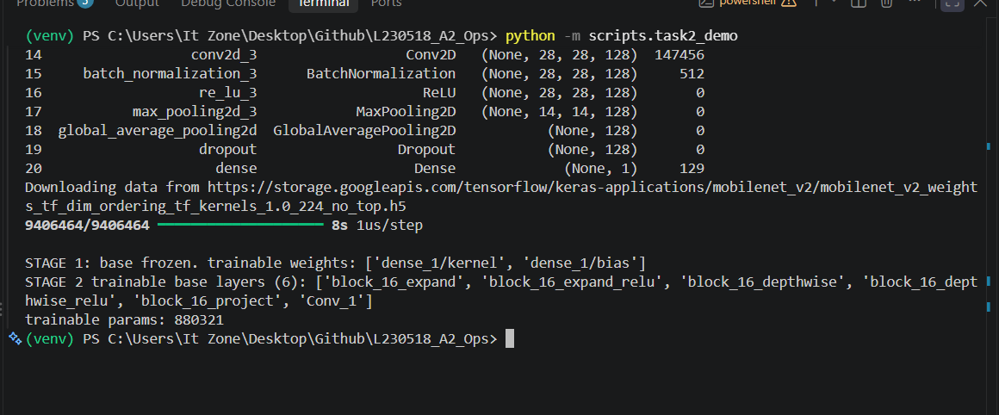
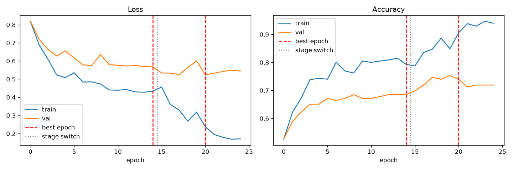
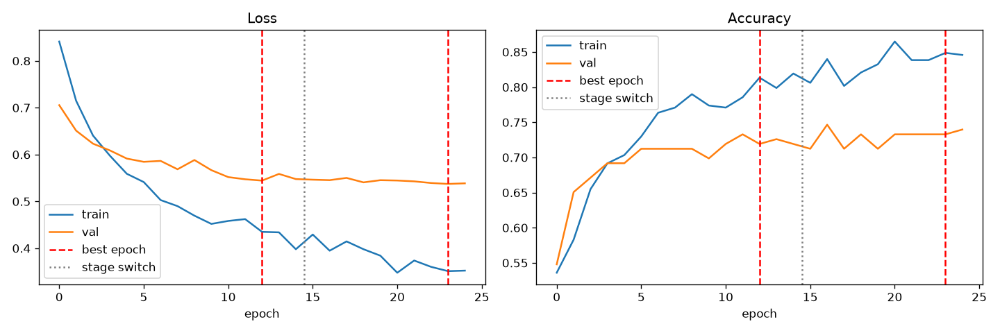

## 2.4 Training discipline

**Seeds.** `keras.utils.set_random_seed(42)` seeds Python, NumPy and TF, and the split and the shuffle also use seed 42.

**Callbacks** (`src/train.py::fit_stage`), on every stage:
- `EarlyStopping(val_loss, patience=5, restore_best_weights=True)`;
- `ModelCheckpoint(models/<run>_<stage>.keras, monitor=val_loss, save_best_only=True)`;
- `ReduceLROnPlateau(val_loss, factor=0.3, patience=2, min_lr=1e-7)`.

**Best epoch.** The best epoch (lowest val_loss) of each stage is logged as `best_epoch_stage1/2` and marked with a red dashed line in the curves.

| Run | Best epoch, stage 1 | Best epoch, stage 2 |
|---|---|---|
| **mobilenet_ft_lr1e-4 (champion)** | **15** (val_loss 0.568) | **6** (val_loss 0.524) |
| mobilenet_manual | 13 (0.544) | 9 (0.537) |
| cnn_baseline | 9 (0.655) | – |

Stage 1 of the champion was still improving at the 15-epoch cap; stage 2 then lowered val_loss further. The CNN overfit after epoch 9, and early stopping restored those weights.

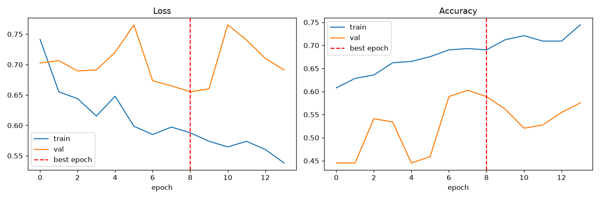

## 2.5 Evaluation (test set, once)

I chose the model and the threshold on **validation** data only. The test set was then used once for each of the two final models (`scripts/final_eval.py`, Figures 2.5a–c, `reports/test_results.csv`). The threshold in that run was the validation-F1-optimal one.

| Model (test, n = 146) | Threshold | Accuracy | Precision | Recall | F1 | ROC-AUC | TN | FP | FN | TP |
|---|---|---|---|---|---|---|---|---|---|---|
| Baseline CNN | 0.364 | 0.582 | 0.571 | 0.950 | 0.714 | 0.669 | 9 | 57 | 4 | 76 |
| **MobileNetV2 fine-tuned** | 0.366 | **0.788** | **0.725** | **0.988** | **0.836** | **0.870** | 36 | 30 | 1 | 79 |

Transfer learning wins on every metric. The CNN's AUC of 0.67 shows that 681 images aren't enough to learn good features from scratch.

**Which error is worse.**
- For VisionGuard, **calling a real photo fake (a false positive)** is worse. It can wrongly accuse a photographer or journalist of fabrication, damage their reputation, and get real evidence dismissed.
- Missing an AI image leaves the user where they were without the tool.

**Threshold choice.**
- The F1-optimal threshold (0.366) flags 30 of 66 real test photos as AI (FPR 45%), which is unacceptable for this product.
- `scripts/threshold_table.py` and `scripts/pick_threshold.py` scan the **validation** ROC curve (Figure 2.5d). They pick the threshold with the highest AI recall subject to **FPR ≤ 20%**, which gives **t = 0.771**.
- Youden's J would pick 0.836, which is even stricter.

| Threshold 0.771 | False-alarm rate (real → AI) | AI recall | Precision | Accuracy |
|---|---|---|---|---|
| Validation | 0.200 | 0.667 | 0.806 | 0.726 |
| Test | **0.182** | 0.688 | **0.821** | 0.747 |

The test false-alarm rate (18%) matches the validation target (20%), so the threshold generalised. The deployed app uses t = 0.771, read from the `THRESHOLD` environment variable.

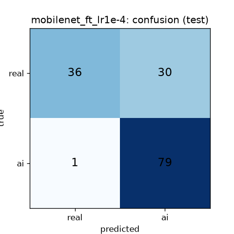
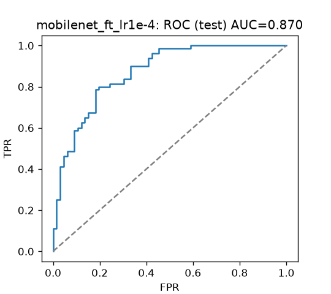
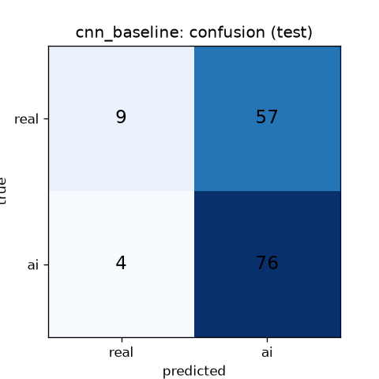
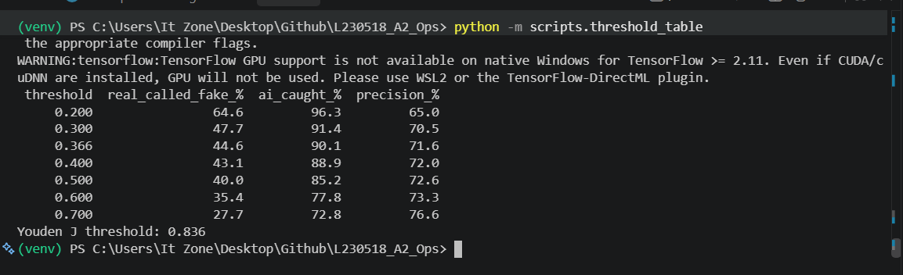

## 2.6 Error analysis

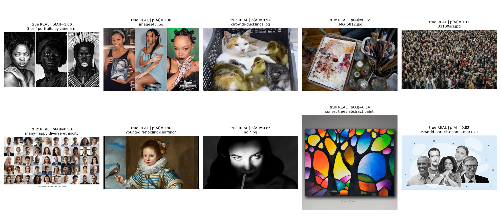

All 10 errors with the highest confidence are **real images predicted as AI**:

| # | Image | p(AI) | Hypothesis |
|---|---|---|---|
| 1 | 3 B&W self-portraits (collage) | 1.00 | high-contrast studio B&W with smooth skin and a stylised pose looks like AI portraits; collage seams |
| 2 | 3-photo collage with a "People" watermark | 0.98 | collage layout + heavy retouching; magazine-style beauty edits resemble AI faces |
| 3 | cat with ducklings | 0.94 | soft, shallow depth of field and "too cute" composition; downscaling hides sensor noise |
| 4 | painter's palette and brushes | 0.92 | saturated paint textures; painting-like content is common in the AI class |
| 5 | huge crowd | 0.91 | repeated faces / texture tiling, similar to the repetition artefacts of generators |
| 6 | stock grid of faces (shutterstock watermark) | 0.90 | grid of uniformly lit, retouched faces; the AI class has many portrait grids |
| 7 | painting of a girl with a chaffinch | 0.86 | **a painting labelled real**: style, not generation, drives the prediction |
| 8 | film-noir portrait | 0.85 | dramatic lighting and smooth gradients, typical of AI "cinematic" prompts |
| 9 | abstract tree painting | 0.84 | flat saturated colours, an artwork, not a photo |
| 10 | cut-out celebrity collage on a pastel background | 0.82 | graphic-design composite with clean edges and no camera noise |

**Conclusion.** The model partly learned "artistic / retouched / composite → AI". This is a dataset bias: the real class contains paintings and edited stock images. It is why the deployed threshold was raised to 0.771, and why the result page carries a caveat about paintings and edited photos.

## 2.7 Tool lab: Keras Tuner

**Toy part** (`scripts/toy_tuner.py`).
- RandomSearch with 8 trials on Fashion-MNIST (10k training images, 2k validation, 5 epochs).
- Search space: `units` ∈ {32, …, 256} and `lr` ∈ [1e-4, 1e-2] on a log scale.

| units | lr | val_accuracy |
|---|---|---|
| **256** | **1.7e-3** | **0.855** |
| 128 | 3.1e-4 | 0.845 |
| 128 | 3.5e-4 | 0.841 |
| 256 | 1.2e-4 | 0.839 |
| 160 | 1.4e-4 | 0.837 |
| 256 | 1.5e-4 | 0.837 |
| 192 | 1.2e-4 | 0.833 |
| 256 | 5.1e-4 | 0.827 |

The best settings (read with `get_best_hyperparameters`) are 256 units and lr ≈ 1.7e-3. For a 5-epoch budget, the learning rate matters more than width: the four slowest learning rates are near the bottom of the table.

**Apply** (`scripts/tune_visionguard.py`).
- A `kt.HyperModel` wraps `build_mobilenet` and searches three things:
  - `dropout` ∈ {0.2, 0.3, 0.4, 0.5};
  - `lr` ∈ [1e-4, 1e-3] on a log scale;
  - `unfrozen_layers` ∈ {0, 10, 30, 60}, the number of last base layers fine-tuned at lr/10.
- RandomSearch ran **8 trials** with the objective of maximising `val_auc` (6 head epochs + 4 fine-tune epochs, early stopping).

| dropout | lr | unfrozen layers | val AUC |
|---|---|---|---|
| **0.3** | **1.75e-4** | **60** | **0.773** |
| 0.3 | 3.53e-4 | 0 | 0.751 |
| 0.3 | 1.87e-4 | 60 | 0.748 |
| 0.4 | 1.10e-4 | 30 | 0.745 |
| 0.3 | 8.20e-4 | 0 | 0.741 |
| 0.2 | 2.03e-4 | 10 | 0.725 |
| 0.4 | 2.79e-4 | 10 | 0.709 |
| 0.3 | 1.09e-4 | 0 | 0.582 |

**Which setting mattered most.**
- **The number of unfrozen layers, together with the learning rate.** With 0 unfrozen layers, the results range from 0.58 to 0.75 depending only on lr. The worst trial (lr 1.1e-4, frozen) simply had not converged in 6 epochs.
- Unfreezing 60 layers gave the two best AUCs (0.773 and 0.748).
- Dropout between 0.2 and 0.4 had no consistent effect.

This agrees with my manual runs (3.5): fine-tuning more of the network with a moderate learning rate helped most.

**Why choosing the best validation score can overfit the validation set.**
- The validation set has only 146 images, and one image is worth about 0.7 percentage points of accuracy.
- Over many trials, some configurations win partly by luck on those particular images. Taking the maximum selects that luck, which is a **winner's curse**: the best trial's validation score is optimistically biased.
- Trials 1 and 3 had almost the same settings (60 layers, lr 1.8e-4 vs 1.9e-4) but AUCs of 0.773 and 0.748, so the noise is about the size of the gaps between trials.
- This is why the **test set is used only once**, after all choices are made, and why the reported performance comes from the test set, not from the best validation score.

⏳ *Add a terminal screenshot of both tuner runs: `img/2.7_toy_tuner.png`, `img/2.7_vg_tuner.png`.*

## Bonus: Grad-CAM

`scripts/gradcam.py` computes Grad-CAM from the last convolutional block of MobileNetV2 (7×7×1280) for 4 correct and 4 wrong test predictions at t = 0.771.

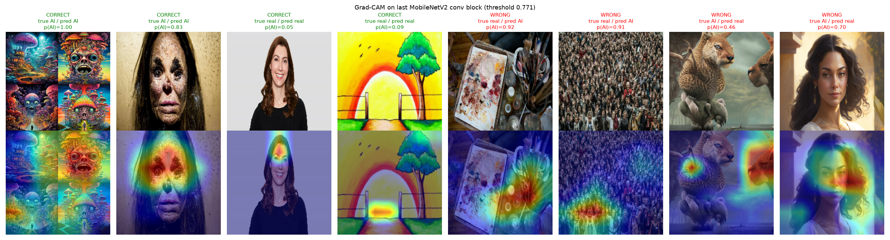

**What the model looks at.**
- **Correct AI cases.** On the psychedelic collage, the heat sits on the over-detailed face with its saturated, repeated textures. On the weathered-face portrait, it covers the eyes and the unnaturally uniform skin "cracks". These are plausible generator artefacts.
- **Correct real cases.** For the studio headshot, the evidence for AI is weak and centred on the face, so p = 0.05. For the child-style drawing, it sits on a small region at the bottom.
- **Real images flagged as AI.**
  - On the paint palette (p = 0.92), the model focuses on the dense, colourful *paint texture* in the corner, not on any photographic flaw.
  - On the crowd photo (0.91), it focuses on the repeated pattern of tiny faces at the bottom.

  Both confirm the hypothesis from 2.6: busy, saturated, repetitive *texture* is read as "AI".
- **AI images missed.**
  - On the leopard (0.46), the attention spreads over the fur and the background, and nothing stands out.
  - On the photorealistic portrait (0.70, just under the 0.771 threshold), the attention is on the face, but the face is clean enough to pass as real.

**Conclusion.**
- The model mostly uses **texture and colour statistics in salient regions** (faces, dense patterns). It is not keying on watermarks or borders, which is good.
- Texture is also its weakness: real artworks and crowded scenes trigger it, and clean photorealistic AI faces escape it.

**What went wrong.**
- My first Grad-CAM version rebuilt the forward pass layer by layer. In Keras 3, `preprocess_input` is stored as a graph op inside the saved model, **not** as a layer in `model.layers`, so the rebuild skipped the [-1, 1] scaling. The heat maps looked plausible, but the probabilities were wrong (0.24 instead of 0.999 for the same image).
- I found it by comparing against the inference module's output. I now re-apply `preprocess_input` and `assert` that Grad-CAM's p(AI) equals `model(x)` for every image. This was a small, real example of the training/serving-skew problem discussed in 4.1.

---

# Chapter 3: Experiment tracking with MLflow and DagsHub

## 3.1 Tool lab: MLflow locally

**What I did.**
- `scripts/toy_mlflow.py local` trains a small dense network on Fashion-MNIST twice, with lr = 0.01 and lr = 1e-4. It logs to a local SQLite store (`sqlite:///toy.db`).
- Each run logs three parameters (`lr`, `units`, `epochs`), per-epoch metrics, one plot (`loss_curve.png`), the Keras model, and the tags `stage=toy` and `target=local`.
- `mlflow ui --backend-store-uri sqlite:///toy.db` opened the UI. I compared the two runs in the parallel-coordinates view (Figures 3.1a–h).

**Result.** lr = 0.01 reached accuracy 0.854 / val 0.824 in 5 epochs; lr = 1e-4 reached 0.791 / val 0.798. The small learning rate is still under-trained after 5 epochs.

**Definitions (my own words):**
- **Experiment**: a named folder that groups runs trying to solve the same problem (`toy-fashion-mnist`, `VisionGuard`).
- **Run**: one execution of the training code, with a unique id, start time, status and source commit.
- **Parameter**: an input I chose before the run that does not change during it (learning rate, dropout). It is logged once.
- **Metric**: a number measured *by* the run, possibly many times with a step (val_loss per epoch, final test F1).
- **Artifact**: any output file stored with the run (plots, split lists, `pip_freeze.txt`, the model).
- **Tag**: free-form key/value metadata about the run (git commit, data hash, seed, "manual" vs "autolog"). It is used to search and filter runs.

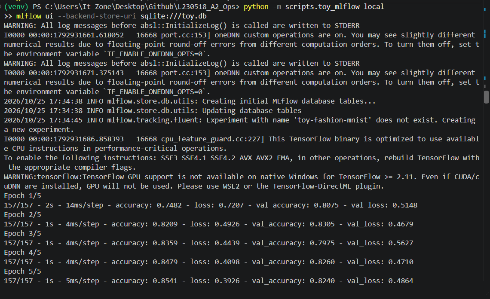
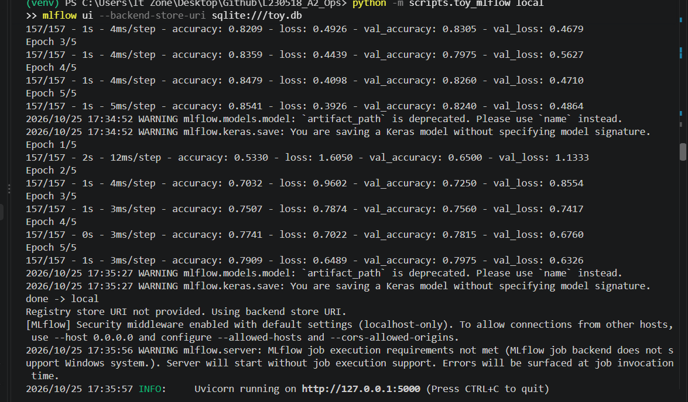
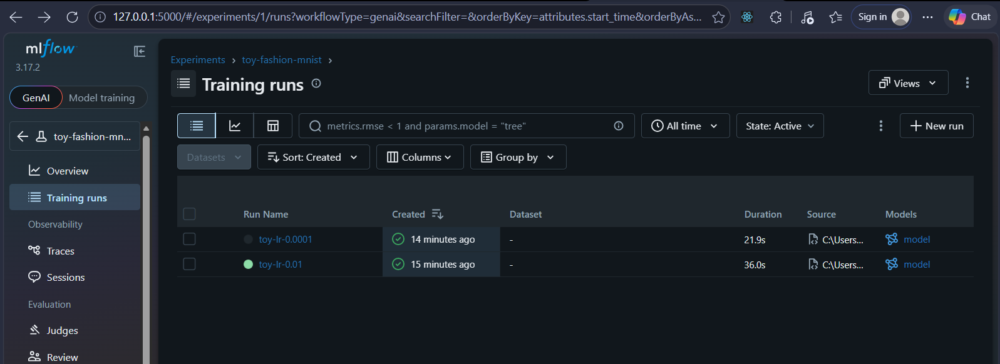
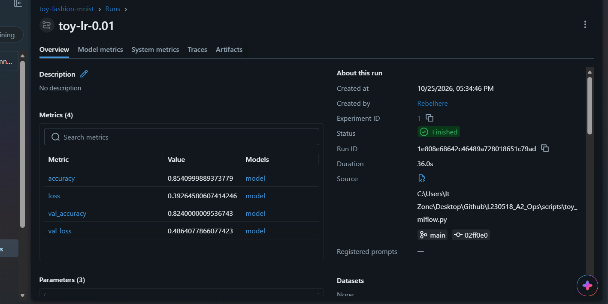
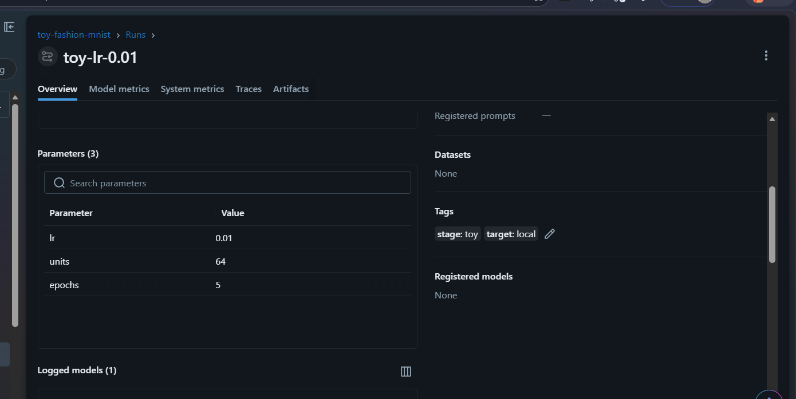
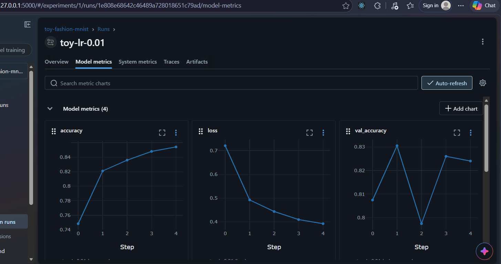
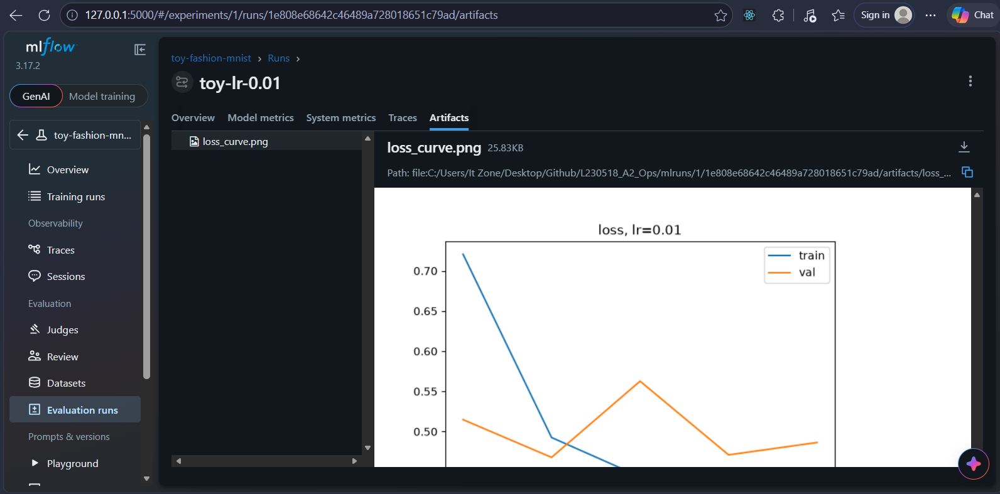
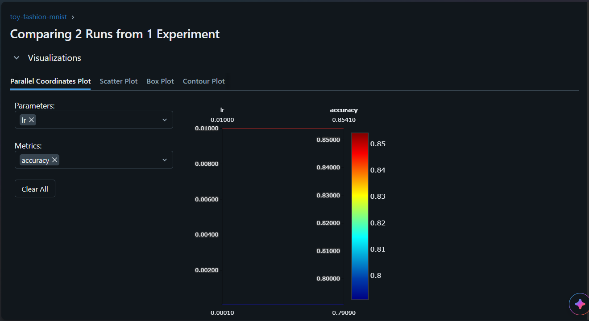

## 3.2 DagsHub setup

**What I did.**
- The DagsHub repository `Rebelhere/L230518_A2_Ops` is connected to the GitHub repository (Figure 1.4k). Its MLflow tracking address is `https://dagshub.com/Rebelhere/L230518_A2_Ops.mlflow`.
- I created a DagsHub access token and stored three values only in `.env`:
  - `MLFLOW_TRACKING_URI`,
  - `MLFLOW_TRACKING_USERNAME`,
  - `MLFLOW_TRACKING_PASSWORD` (the token).
- The code calls `load_dotenv()`, and MLflow reads these variables automatically, so no credential appears in source code.
- `.env` is git-ignored: `git check-ignore -v .env` → `.gitignore:2:.env`, and `git status` doesn't list it (Figure 3.2a). `.env.example` documents the variable names without values.
- I repeated the toy run against DagsHub (Figure 3.2b).

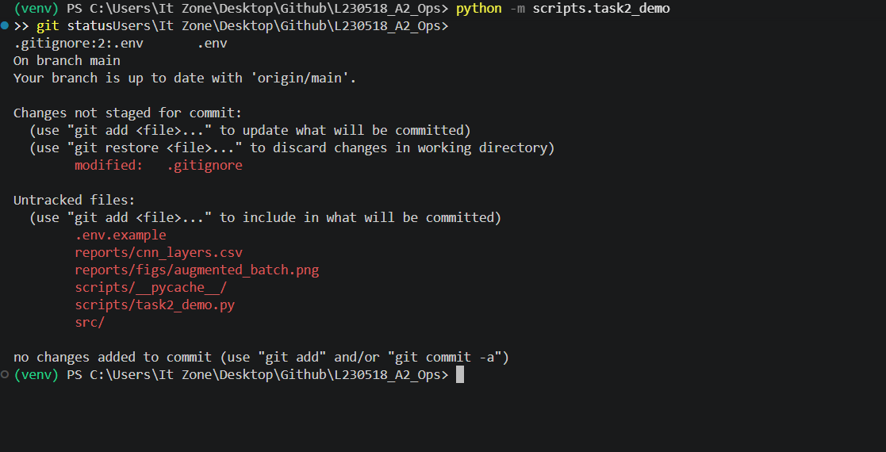
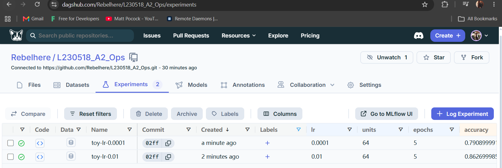

## 3.3 Instrumenting VisionGuard training

`src/train.py` logs every run to the `VisionGuard` experiment:
- **Tags:**
  - `git_commit` (from `git rev-parse HEAD`);
  - `dvc_data_md5` (the hash read from `data.dvc`, which ties the run to the exact data version);
  - `seed=42`;
  - `model`;
  - `logging`.
- **Parameters:** every CLI argument (lr, ft_lr, dropout, epochs, ft_epochs, augmentation), plus img_size and batch.
- **Per-epoch metrics:** loss, accuracy, precision, recall and AUC for training and validation.
- **Final metrics:** `best_epoch_stage*`, `threshold`, `final_val_*` and, with `--test`, `test_*`.

**Manual approach** (`--logging manual`, run `mobilenet_manual`, Figures 3.3a–e).
- A custom Keras callback `EpochLogger` calls `mlflow.log_metrics(logs, step=offset+epoch)` at the end of each epoch.
- The step offset makes stage 2 continue on the same x-axis as stage 1.
- I decide exactly what is logged and how it is named.

**Autolog approach** (`--logging autolog`, run `mobilenet_autolog`, Figures 3.3f–g). `mlflow.tensorflow.autolog()` hooks into `model.fit` and captures, without any code:
- every `fit` argument and optimizer setting (43 parameters, e.g. `opt_name=adam`, `opt_learning_rate`, `batch_size`, `class_weight`);
- per-epoch metrics;
- a model summary;
- TensorBoard logs;
- early-stopping info.

**What each approach captures or misses.**
- **Autolog is broad but generic.**
  - Every `fit()` call starts its step counter at 0, so the stage-2 curves overwrite stage 1 instead of continuing it (its charts show only 2 steps).
  - It can't know domain values: the validation-chosen threshold, the test metrics, the confusion matrix, or the data hash.
- **Manual logging is precise but only as complete as my code.** It missed the optimizer internals, which autolog logged for free.

I kept both: autolog for the automatic extras, plus manual calls for the domain values.

**What went wrong.**
- The first autolog run **failed** (red ✗ in Figures 3.3h–i). Autolog tried to log the model with `mlflow.keras.log_model`, which failed for the nested MobileNetV2 model.
- MLflow 3 had also deprecated `artifact_path` there.
- I set `log_models=False`, wrapped `log_model` in try/except, and save the `.keras` file as a plain artifact (`model_file/`) as a fallback. `scripts/finish_autolog_run.py` completed the logging for the autolog run.

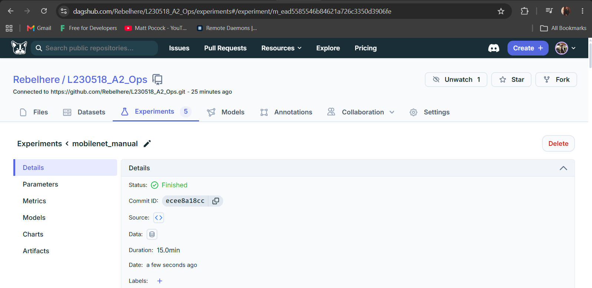
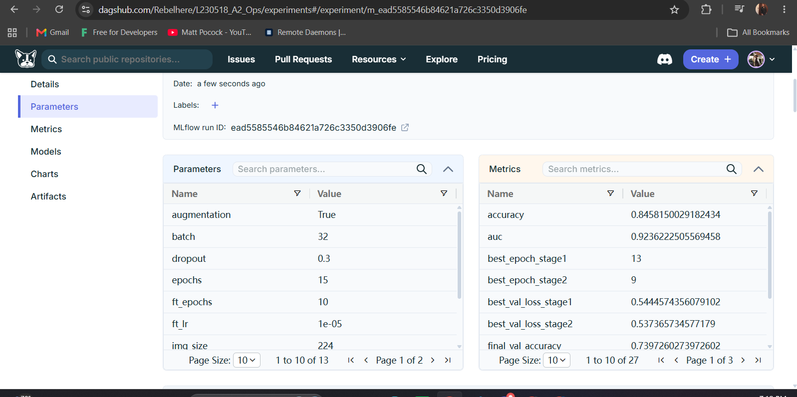
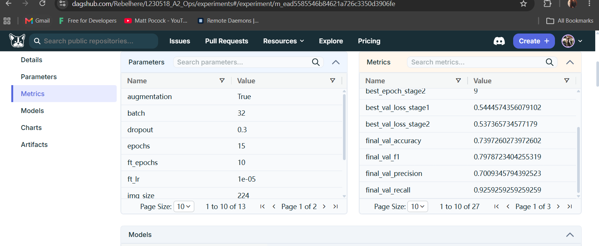
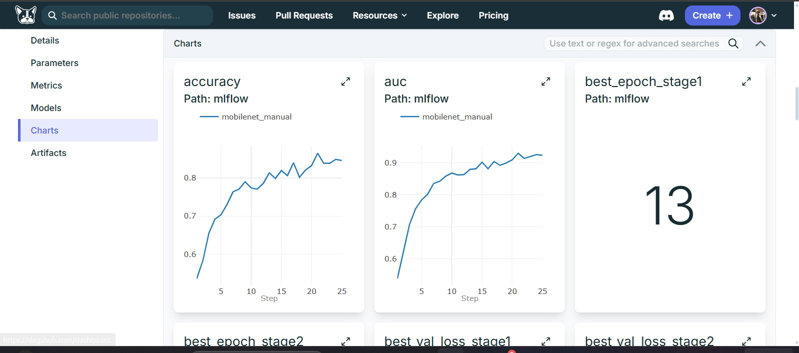
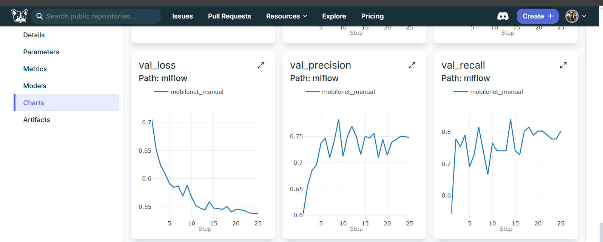
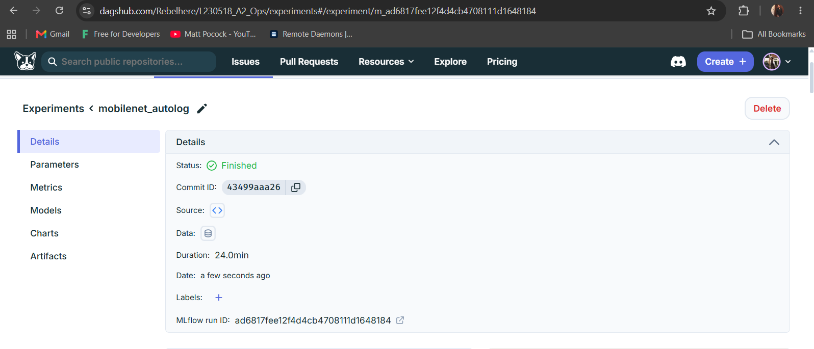
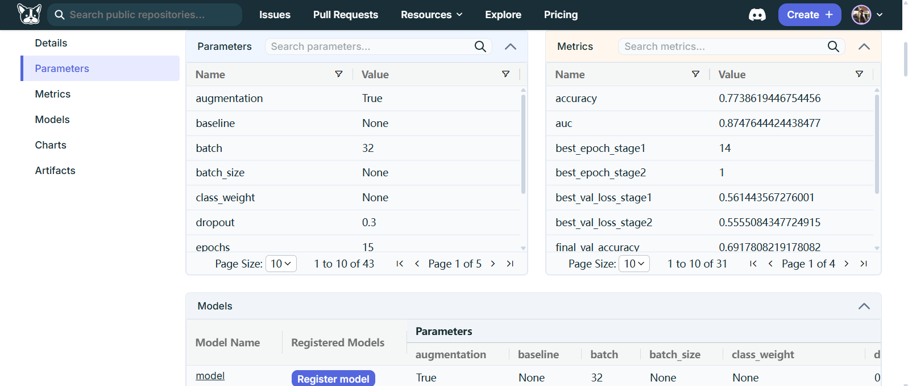


## 3.4 Artifacts

Every run attaches these artifacts (Figures 3.4a–d):
- `confusion_matrix_<split>.png` and `roc_curve_<split>.png`;
- `splits/train.csv`, `val.csv` and `test.csv` (the exact split lists);
- `pip_freeze.txt` (the package list);
- the trained Keras model (`model/`, or the `.keras` file in `model_file/`);
- `curves.png`.

The autolog run additionally has `checkpoints/`, `tensorboard_logs/` and `model_summary.txt`.


## 3.5 Experiment comparison

I ran 7 runs (Figures 3.5a–i, `reports/comparison.csv`). Each differs from `mobilenet_manual` (head lr 1e-3, ft lr 1e-5, augmentation on, 10 fine-tune epochs) in **one** change:

| Run | Single change vs mobilenet_manual | val acc | val prec | val rec | val F1 | **val AUC** |
|---|---|---|---|---|---|---|
| **mobilenet_ft_lr1e-4** | fine-tune lr 1e-5 → **1e-4** | **0.753** | **0.718** | 0.914 | **0.804** | **0.835** |
| mobilenet_manual | (reference) | 0.740 | 0.701 | 0.926 | 0.798 | 0.807 |
| mobilenet_no_aug | augmentation off | 0.705 | 0.670 | 0.926 | 0.777 | 0.803 |
| mobilenet_head_only | no fine-tuning stage (frozen base) | 0.712 | 0.689 | 0.877 | 0.772 | 0.781 |
| mobilenet_autolog | logging method only (control) | 0.692 | 0.658 | 0.926 | 0.769 | 0.779 |
| mobilenet_lr1e-4 | head lr 1e-3 → 1e-4 | 0.658 | 0.637 | 0.889 | 0.742 | 0.752 |
| cnn_baseline | backbone: MobileNetV2 → own CNN | 0.610 | 0.590 | 0.975 | 0.735 | 0.639 |

**Choice: `mobilenet_ft_lr1e-4`.** These are the metrics I consider most important, in order:
1. **ROC-AUC.** It is independent of the threshold. I move the threshold afterwards to control false alarms, so ranking quality is what the model itself must provide.
2. **Precision.** Few real photos are called fake.
3. **F1.**

The chosen run is best on all three. It is the only run that also improved stage-2 val_loss clearly (0.524 vs 0.537).

**What each single change taught me:**
- Fine-tuning helps (head_only is −0.03 AUC).
- Augmentation helps slightly.
- A smaller head lr under-trains in 15 epochs.
- A from-scratch CNN is far worse.
- The autolog "control" differs from manual by 0.03 AUC with an identical configuration. That is a reminder of run-to-run noise on 146 validation images, the same effect discussed in 2.7.


## 3.6 Model registry

**What I did.**
- `scripts/register_models.py` registered **`L230518_A2_Ops_VisionGuard`** from the runs' model files, with two versions:
  - **version 1** is `mobilenet_manual`, alias `challenger`;
  - **version 2** is `mobilenet_ft_lr1e-4`, alias **`champion`**.
- Each version carries the tags `run_name` and `threshold` (Figure 3.6a).
- `scripts/load_champion.py <image>` resolves `models:/…@champion` with `MlflowClient.get_model_version_by_alias`, downloads that version's `.keras`, loads it and classifies one image.

**How the champion file reaches the server (and why not per request).**
- `scripts/export_champion.py` downloads the champion **once** into `models/champion.keras` and writes `champion_meta.json` (version 2, run id).
- The web container mounts that folder, and the cloud API image has it built in.
- Serving therefore never calls DagsHub. A registry call per request would add seconds of latency, fail whenever DagsHub is down, and hit API rate limits.
- Promoting a new model means: move the alias, re-run the export, then restart or rebuild.


⏳ *Add a terminal screenshot of `python -m scripts.load_champion <image>`: `img/3.6_load_champion.png`.*

---

# Chapter 4: Flask web application

**Code layout:**
- `app/` is the web app: the factory, routes, database and templates.
- `serving/` holds the inference and validation code shared with the API.
- `api/` is the cloud model API.
- `wsgi.py` is the production entrypoint.

## 4.1 Inference module

`serving/inference.py::Predictor` (Figure 4.1):
- loads `champion.keras` **once** in its constructor;
- reads the version from `champion_meta.json`;
- runs one warm-up prediction.

`predict(bytes)` calls the **same function used in training**, `src/preprocess.py::decode_resize` (decode to 3 channels, then bilinear resize to 224×224). Then it runs the model, which contains `preprocess_input` internally, and returns:
- `label`: "AI-generated" if p ≥ threshold, else "Real";
- `p_ai`;
- `confidence`: p for AI, 1−p for Real;
- `threshold`, `model_name`, `model_version` and `latency_ms`.

Measured on my laptop: **loading the model takes 36.7 s; one prediction takes about 0.3 s.**

```
model v2 loaded once in 36.7s, threshold 0.771
…/AiArtData/…qFcGNfN66Fp4….jpeg   -> {'label': 'AI-generated', 'p_ai': 0.9994, 'confidence': 0.9994, …, 'latency_ms': 337.2}
…/RealArt/…lindsey-pattison….jpg  -> {'label': 'Real', 'p_ai': 0.0462, 'confidence': 0.9538, …, 'latency_ms': 268.5}
```

**Why loading per request is unacceptable.**
- Every request would take about 37 s instead of 0.3 s, roughly a 100× slowdown.
- Every request would re-read 17 MB from disk and re-allocate the whole TF graph.
- Concurrent users would multiply the memory use and crash the container.

Loading once at start-up pays the cost one time, and every request after that is fast.

**Why training and serving preprocessing must match.**
- The model only learned the mapping for inputs prepared the training way.
- Typical drifts include:
  - [0, 1] instead of [0, 255] scaling;
  - a crop instead of a stretch;
  - RGBA handled differently;
  - nearest-neighbour instead of bilinear resizing.
- Any of these produces inputs the model never saw. The predictions then silently degrade (training/serving skew), and no error is raised.
- I avoid this by construction: both paths import the same `decode_resize`, and the [-1, 1] scaling lives inside the saved model.

⏳ *Screenshot of the same command in your terminal:* `python -m serving.inference <ai.jpg> <real.jpg>` → `img/4.1_inference_console.png`

## 4.2 Routes and validation

| Route | Purpose |
|---|---|
| `GET /` | upload page |
| `POST /predict` | validate, predict, write a DB row, then redirect (303) to the result. The Post/Redirect/Get pattern means a refresh doesn't resubmit. |
| `GET /result/<id>` | result page, read back from the DB |
| `GET /history` | paginated history from the DB |
| `GET /health` | JSON health check |

**Validation** (`serving/validation.py`):
1. **Wrong type.** Only `.jpg`, `.jpeg` and `.png` are accepted, the formats the model was trained on. Anything else returns 400 "Unsupported file type".
2. **Too large.** `MAX_CONTENT_LENGTH` = `MAX_UPLOAD_MB` (5 MB). Werkzeug rejects larger uploads *before reading them*, and a custom 413 page explains the limit.
3. **Looks like an image but can't be decoded.** Pillow fully decodes the bytes (`Image.open` + `load`). A `.jpg` containing junk returns 400 "could not be decoded". The content format must also really be JPEG or PNG, whatever the extension says.

**Other protections:**
- **File names** are sanitised with `werkzeug.secure_filename`, so `../../evil name.png` is stored as `evil_name.png` and can't escape a folder.
- **Nothing is kept on disk.** Werkzeug normally spools uploads over 500 KB into a temporary file. `app/__init__.py::InMemoryRequest` overrides `_get_file_stream` to use `BytesIO`, so the image only ever exists in RAM (bounded by the size limit) and is discarded after the request. Only its SHA-256 is stored.
- **Friendly error pages** (`error.html`) cover 400, 404, 413, 503 (model API down) and 500. The 500 page logs the stack trace but never shows it to the user.
- **Tests.** `tests/test_app.py` checks all three failure cases, file-name sanitising, the DB trail, `/health`, the 404 page and the API key (8 tests, all passing).


## 4.3 HTML and CSS

There are four Jinja templates extending `base.html`, which has a nav bar with **Upload · History · Health** and one stylesheet (`app/static/style.css`). It uses no JavaScript framework; a 5-line script shows a preview of the chosen image.

**The result page shows:**
- the verdict ("Likely AI-generated" or "Likely real");
- the confidence;
- a bar with the p(AI) position and the threshold mark;
- the model name and version, where the prediction was served from, the latency and the timestamp;
- an **honest caveat** in plain words: the model is right about 3 in 4 times, flags roughly 1 in 5 real photos, and is confused by paintings and edited images, so the user shouldn't accuse anyone on this basis alone.

The caveat numbers are the measured test results from 2.5. The layout is responsive down to phone width.

*The grey bar at the top of Figures 4.2–4.4 shows the page URL and capture time. A Playwright script added it while driving my local Chrome against the app on `localhost:5050` (real champion model, SQLite), because headless screenshots don't include the browser's own address bar.*


## 4.4 Configuration and production server

**Configuration.** `app/config.py` reads **every** setting from environment variables: `MODEL_PATH`, `THRESHOLD`, `DATABASE_URL`, `MAX_UPLOAD_MB`, `INFERENCE_MODE`, `MODEL_API_URL`, `MODEL_API_KEY`, `MODEL_API_TIMEOUT` and `SECRET_KEY`. The same image therefore runs locally, in Compose or in the cloud, with nothing hard-coded, and secrets stay out of Git and out of the image.

**Server.**
- The app runs with `python wsgi.py web`, which serves the Flask app through **waitress**, a production WSGI server, with **`debug=False`**.
- **Why not `flask run --debug`.** The Werkzeug development server is single-process and not hardened. Debug mode exposes an interactive debugger that can execute arbitrary Python from the browser, which means remote code execution. It also reloads code and leaks stack traces.
- **Why waitress.** It handles concurrent requests with a thread pool and runs on both Windows and Linux.

**Health check.** `/health` returns:

```json
{"database":"ok","inference_mode":"local","model_loaded":true,"model_version":"2","status":"ok","threshold":0.771}
```

The status code is 503 if the DB is unreachable. Docker uses this endpoint as the container `HEALTHCHECK`.


---

# Chapter 5: Database trail

**Table.** `app/db.py` defines one SQLAlchemy table, `predictions`:

| Column | Answers |
|---|---|
| `id`, `created_at` (UTC, indexed) | **when** |
| `filename` (sanitised), `sha256` | which image, without storing it |
| `label`, `p_ai`, `threshold` | **what was decided** |
| `confidence` | **how confidently** |
| `model_name`, `model_version` | **by which model** |
| `mode` (local / remote), `latency_ms` | where it ran, and how fast |

**Database.** In Docker it is **PostgreSQL 16**. Without Docker the same code uses SQLite; only `DATABASE_URL` changes.

**The view.**
- `POST /predict` inserts a row after every successful prediction, before redirecting.
- The **History** menu (`/history`) reads the rows newest first, 20 per page, and shows time, file, decision, confidence, p(AI), model version, where it was served and latency.
- Each row links to its result page, which is also rendered from the database.
- Rejected uploads are not stored (no decision was made), but they are logged.

**Querying it directly** (Figure 5b):

```sql
SELECT id, created_at, label, round(p_ai::numeric,3), model_version, mode FROM predictions ORDER BY id DESC;
```


⏳ 

---

# Chapter 6: Containerisation with Docker and Docker Compose

## 6.1 Docker warm-up

⏳ *Screenshots `6.1a`–`6.1f`, following `report/RUNBOOK.md` §6.1, with the ready-made `nginx:alpine` image: pull/images, run with `-p 8081:80` and `-v`, browser, logs, `exec sh`, then stop/rm/rmi.*

**Definitions (my own words):**
- **Image**: a read-only template (filesystem + metadata such as the default command), built from a Dockerfile and identified by name:tag.
- **Container**: a running (or stopped) instance of an image. It is a process with its own isolated filesystem, network and process space, plus a thin writable layer on top of the image.
- **Layer**: each Dockerfile instruction produces a filesystem diff. Layers are stacked, shared between images and cached, so unchanged steps are not rebuilt.
- **Volume**: storage managed outside the container's writable layer. Data in it survives container removal (our Postgres data), or it maps a host folder into the container (our model).
- **Port mapping** (`-p host:container`): forwards a port on the host to a port inside the container's private network, e.g. `-p 5000:5000` makes the app reachable at localhost:5000.

## 6.2 Dockerfile for the web app

The file is [`Dockerfile`](https://github.com/Rebelhere/L230518_A2_Ops/blob/main/Dockerfile). The order of instructions, and why:
1. **`FROM python:3.12-slim`.** It is Debian slim: about 120 MB instead of about 1 GB for the full `python:3.12` image. It still uses glibc, so TensorFlow wheels install without compiling (Alpine's musl would force source builds).
2. **`ENV`.** No `.pyc` files, unbuffered logs, `PIP_NO_CACHE_DIR`, and TF log level 2.
3. **Copy only the requirements files, then `pip install --no-cache-dir`.**
   - This layer is the slowest and biggest (TensorFlow).
   - Docker reuses a cached layer as long as its inputs are unchanged. Because only the requirements files are copied before it, editing Python code **doesn't** invalidate this layer.
   - A code change rebuilds in seconds instead of re-downloading about 600 MB.
4. **Copy the source code last** (`src/config.py`, `src/preprocess.py`, `serving/`, `app/`, `api/`, `wsgi.py`).
5. **`useradd app` + `USER app`.** The container runs as an unprivileged user (UID 10001). A compromise of the app would not have root inside the container.
6. **`HEALTHCHECK`.** It calls `/health` every 30 s, with a 60 s start period because the model takes time to load. Docker and Compose then report `healthy` or `unhealthy`.
7. **`CMD ["python", "wsgi.py", "web"]`.** It starts waitress, with debug off.

**Ignore file.** `.dockerignore` excludes `venv/`, `data/` (500 MB), `mlruns/`, `tuner_logs/`, `.git`, `.env` and all non-champion models. This keeps the build context small and **keeps secrets out of the image**.

**Secrets.** No secret appears in the Dockerfile. Passwords and keys arrive at run time as environment variables, from Compose or Cloud Run.

**TensorFlow package.** I chose **`tensorflow-cpu==2.21.0`** (with `keras==3.15.1`, the training versions) instead of `tensorflow`.
- The full Linux wheel bundles CUDA/GPU kernels, which the server (no GPU) would never use, and its installed size is several hundred MB bigger.
- Inference on one 224×224 image takes about 0.3 s on a CPU, which is fast enough for this product.

⏳ 

## 6.3 Compose stack

The file is [`docker-compose.yml`](https://github.com/Rebelhere/L230518_A2_Ops/blob/main/docker-compose.yml). It defines two services:
- **`db`**: `postgres:16-alpine`.
  - Data lives in the **named volume `pgdata`**, so history survives `docker compose down` and rebuilds.
  - **Health check:** `pg_isready` every 5 s.
  - It has **no `ports:` section**, so Postgres is reachable only on Compose's internal network and is closed from outside.
- **`web`**: built from the Dockerfile.
  - `depends_on: db: condition: service_healthy` means it starts only when Postgres accepts connections, so it never crashes on a not-yet-ready DB.
  - It reaches the DB **by service name**: `DATABASE_URL=postgresql+psycopg://…@db:5432/…`. Compose's internal DNS resolves `db`.
  - It publishes port 5000 for the browser.

**Passwords.** All passwords and keys are `${VAR}` substitutions read from the untracked `.env`. `.env.example` (committed) lists every variable with placeholder values.

**How the model reaches the container: mounted.** `./models:/models:ro` (read-only bind mount). Reasons:
- The model is versioned by the **registry**, not by the image. Promoting a new champion means re-running `scripts/export_champion.py` and restarting the container, with no rebuild.
- The 17 MB model is not baked into an image that CI builds from GitHub, where `models/` is git-ignored.
- Read-only means the app can't modify it.

For the cloud, the opposite choice is right, and `Dockerfile.api` builds the model in. That is explained in Chapter 7.

⏳ 
⏳ 

## 6.4 Image analysis

⏳ *Fill in after running RUNBOOK §6.4:*

| Image | Base | TF package | pip cache | Size |
|---|---|---|---|---|
| `visionguard:naive` (`Dockerfile.naive`) | python:3.12 (full) | tensorflow | kept | ⏳ |
| `l230518_a2_ops-web` (`Dockerfile`) | python:3.12-slim | tensorflow-cpu | none | ⏳ |

**Largest layers.** `docker history` shows which layers are largest. By far the largest is the `pip install` layer (TensorFlow, about 90% of the image), followed by the base OS layer. The source code layers are only kilobytes.

**Optimisation applied.** A slim base, the CPU-only wheel, `--no-cache-dir` and the ignore file. ⏳ *Conclusion with the two numbers.*

## 6.5 Operations and troubleshooting

⏳ *Screenshots for start/stop/restart/logs/exec in both services (RUNBOOK §6.5).*

**Deliberate failure: missing model file.**
1. I renamed `models/champion.keras` and recreated `web`. The container exited and restarted in a loop.
2. **Diagnosis, from the logs only** (`docker compose logs web`):

   ```
   ⏳ FileNotFoundError: model file not found at /models/champion.keras (run scripts/export_champion.py or mount the models folder)
   ```

   The traceback ends in `Predictor.__init__`, which runs at start-up, so the problem is the mount or the file, not the code.
3. **Fix:** restore the file (or re-export the champion), then `docker compose up -d --force-recreate web`. The service returned to `healthy`.

I made the error message name the exact path and the command that fixes it, so that this diagnosis works from logs alone.

---

## 6.6 Tool lab: GitHub Actions (CI)

**Toy part.** The repository `Rebelhere/L230518_A2_Ops_ci_toy` has a workflow `.github/workflows/ci.yml`:
- it runs on every push;
- it uses a **matrix of Python 3.11 and 3.12**;
- it installs pytest and runs `test_calc.py`.

I changed one assertion to make it fail (red run), then fixed it (green run).

⏳  ⏳ 

**Apply.** The VisionGuard workflow (`.github/workflows/ci.yml`) has two jobs:
- **`test`**: checkout, set up Python 3.12 with a pip cache, install `requirements-app.txt` + pytest + ruff, then **lint** with `ruff check` and run the **tests** with `pytest`.
  - The tests use a fake predictor and SQLite, so CI doesn't need TensorFlow or the model and takes about a minute.
- **`docker`**: needs `test` to pass, then **builds the Docker image**, which proves the Dockerfile and requirements still work.

The README shows the status badge.

**Where workflow secrets are stored.** In the repository's **Settings → Secrets and variables → Actions**. They are encrypted at rest, injected only at run time as `${{ secrets.NAME }}`, and masked as `***` in logs. They must never be written in the workflow file. That file is committed to Git, so everyone who can read the repository (here, the whole internet) would see the secret, and it would stay in the Git history forever even after deletion. This workflow needs no secrets at all.

⏳  ⏳ 

---

# Chapter 7: API deployment (Google Cloud Run, pathway C)

**Why not Vercel.**
- Vercel's Python functions are limited to about 250 MB unzipped, and TensorFlow alone is bigger, so the model can't run there.
- Functions also have no persistent disk (SQLite would vanish) and short time limits.

**Why Cloud Run.** It runs any container:
- 2 GiB memory;
- HTTPS by default;
- scales to zero when idle;
- the free tier (2 M requests and 360k GiB-seconds per month) covers this project.

**Mapping the Compose elements to Google Cloud:**

| Compose element | Cloud equivalent |
|---|---|
| `build:` / image | image pushed to **Artifact Registry** (`us-central1-docker.pkg.dev/l230518-a2-ops/l230518-a2-ops/api`) |
| service container | **Cloud Run service** `l230518-a2-ops-api` |
| `environment:` / `.env` | `--set-env-vars` (key, threshold) |
| `ports: 5000:5000` | Cloud Run's HTTPS URL → container `$PORT` 8080 |
| `HEALTHCHECK` / `/health` | Cloud Run startup probe on the port + `/health` |
| `restart: unless-stopped` | Cloud Run restarts failed instances automatically |
| `db` + `pgdata` volume | stays on localhost with the Flask app (Task 7: Flask runs locally) |

**Model API** (`api/main.py`):
- **`POST /predict`** takes a multipart field `image` and the header `X-API-Key`.
  - The key is compared with `hmac.compare_digest`, so the comparison takes constant time.
  - It uses the same validation and `Predictor` as the web app, and returns JSON.
- **`GET /health`** is public.
- The API **refuses to start without `MODEL_API_KEY`**, so it can never run unprotected by mistake.

**Model delivery.** `Dockerfile.api` **builds the champion model into the image**. Cloud Run has no host folder to mount, and a baked image is an immutable, versioned unit (tag `api:v2` = registry version 2). Serving still never calls DagsHub.

**Step-by-step deployment** (commands in RUNBOOK §7):
1. Create the GCP project `l230518-a2-ops` and link billing. ⏳ *Figure 7a*
2. `gcloud auth login`, then `gcloud config set project l230518-a2-ops`.
3. `gcloud services enable run.googleapis.com artifactregistry.googleapis.com`.
4. Create the Docker repository: `gcloud artifacts repositories create l230518-a2-ops --repository-format=docker --location=us-central1`.
5. `gcloud auth configure-docker us-central1-docker.pkg.dev`, so Docker can push to it.
6. `python -m scripts.export_champion`, so `models/champion.keras` is the registry champion.
7. Build and push: `docker build -f Dockerfile.api -t …/api:v2 .` then `docker push …/api:v2`. ⏳ *Figure 7b*
8. Deploy with `gcloud run deploy l230518-a2-ops-api --image …/api:v2 --region us-central1 --memory 2Gi --cpu 1 --cpu-boost --timeout 120 --min-instances 0 --max-instances 1 --allow-unauthenticated --set-env-vars MODEL_API_KEY=…,THRESHOLD=0.771`. ⏳ *Figure 7c, which shows the service URL.*
   - `--max-instances 1` caps cost.
   - `--cpu-boost` shortens the cold start, while the model loads.
   - `--allow-unauthenticated` only makes the URL reachable; `/predict` still requires the API key.
9. Check the service page and logs in the console. ⏳ *Figures 7d, 7e*

**API URL:** ⏳ `https://l230518-a2-ops-api-….run.app` (endpoints `/health`, `/predict`).

**Postman test from another network** (mobile hotspot):
- `POST /predict`, header `X-API-Key`, form-data `image` → 200 with JSON. ⏳ *Figure 7f*
- The same call without the key → 401 `missing or invalid X-API-Key`. ⏳ *Figure 7g*
- A `.txt` file → 400. ⏳ *Figure 7h*

**What went wrong / limits.**
- The first request after idle is a **cold start**: the container starts and loads TF and the model, which takes about 10–20 s. Later requests take well under a second.
- The free tier would normally keep one warm instance with `--min-instances 1`, but that costs money, so I accepted cold starts.

---

# Chapter 8: Integrating Flask and the API

**How it works.**
- The Flask app keeps running on **localhost** in Docker Compose, with Postgres beside it.
- With `INFERENCE_MODE=remote`, `app/predictors.py::RemotePredictor`:
  - keeps one `requests.Session` with the `X-API-Key` header set;
  - POSTs the validated image bytes to `MODEL_API_URL/predict`, with a 30 s timeout that is enough for a cold start;
  - stores the returned decision in the database with `mode='remote'`.
- If the API is unreachable or returns an error, the user sees a friendly 503 page and nothing wrong is logged as a decision.
- `/health` also reports whether the cloud API is reachable and which model version it serves.

**Why this design.**
- The same web code runs both ways; only environment variables change.
- The heavy model runs in the cloud.
- The database and the UI stay local, as the task asks.

**Demonstration.** ⏳ *Screenshots, captured after deployment:*
- `/health` in remote mode;
- 5 or more different uploads: AI, real, PNG, and a wrong file;
- the History page showing **Served by: cloud API**;
- the matching Cloud Run log lines with the same SHA-256 prefixes.

---

# Chapter 9: Summary and what I learned

| Task | Status |
|---|---|
| 1 Data and DVC | ✔ |
| 2 Models, evaluation, tuner | ✔ (+ Grad-CAM bonus) |
| 3 MLflow / DagsHub / registry | ✔ |
| 4 Flask app | ✔ |
| 5 Database | ✔ |
| 6 Docker / Compose / CI | ✔ ⏳ screenshots |
| 7 Cloud API | ⏳ |
| 8 Integration | ⏳ |

**Key lessons:**
1. **Measure the threshold, don't assume 0.5.** The business cost of false alarms moved it to 0.771.
2. **Share one preprocessing function** between training and serving.
3. **Load the model once.** 37 s vs 0.3 s.
4. **A small validation set makes "best run" noisy.** That is why the test set is used once, at the very end.
5. **The dataset's "real" class contains paintings and edited images**, and the model learned style as a shortcut. A better dataset would be the most valuable next step.
